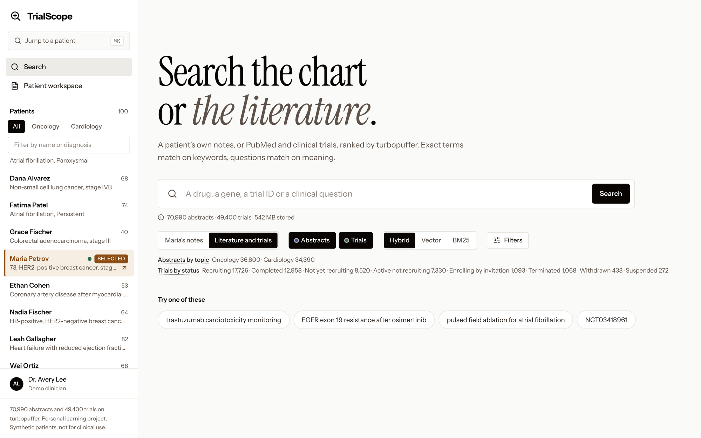
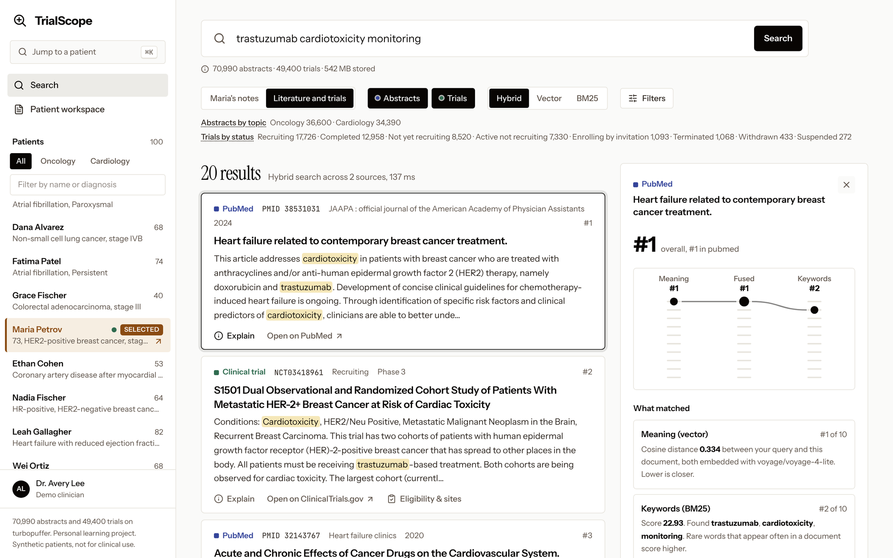
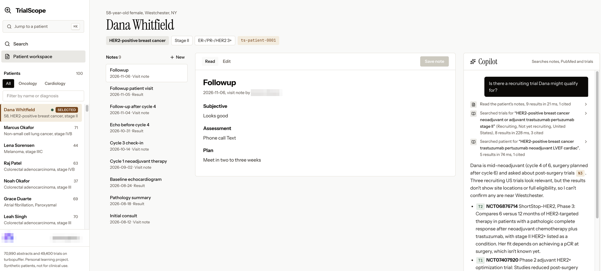
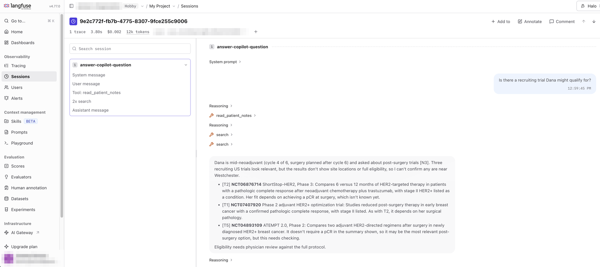

# TrialScope Match

Find clinical trials and research for a patient, with a relational database and a search engine side by side. The
patient's record (conditions, medications, labs, biomarkers) and clinical notes live in
[Supabase](https://supabase.com) Postgres; PubMed abstracts and ClinicalTrials.gov records are searched in
[turbopuffer](https://turbopuffer.com). A Claude copilot reads exact facts from SQL, then uses them to filter and
word its turbopuffer searches, and answers with citations. Notes are synced from Postgres into turbopuffer, so you
can search them across every patient, alone or combined with record filters; and every trial page lists which
patients could fit it, scored by one SQL query against rules read from the criteria. Built with Next.js, deployed on
Vercel.

> **Personal learning project.** I built TrialScope Match on my own time to learn how a transactional database and a
> search engine split the work in one app, and how an AI copilot can sit on top of both. It is not affiliated with,
> sponsored by or endorsed by turbopuffer, Supabase, Anthropic, Vercel, the NIH/NLM, ClinicalTrials.gov or any employer.
>
> **Not for clinical use.** Every patient, record and note is fictional, generated by a script. PubMed abstracts and
> trial records are public data shown for demonstration only and may be incomplete or out of date. Nothing here is
> medical advice.

This started as a copy of [jgerson/trialscope-vercel](https://github.com/jgerson/trialscope-vercel), where everything,
patients and notes included, lives in turbopuffer. That app and its data are unchanged: this one only reads the two
shared corpora from turbopuffer, keeps its own patient data in Supabase, and writes only to its own turbopuffer
namespace, `match-notes`.

## Where the data lives

| Store | What | Access from the app |
| --- | --- | --- |
| **Supabase Postgres** | `patients`, `conditions`, `medications`, `observations` (labs and biomarkers), `notes` (the source of truth for notes), `trial_rules` (cached criteria rules) | Read, insert and update, as the `trialscope_app` role (no deletes, no schema changes) |
| **turbopuffer** | `ts-trials` (49,400 interventional studies), `ts-pubmed` (70,990 abstracts): the original app's shared corpora | Read only |
| **turbopuffer** | `match-notes`: every note, synced from Supabase (keyword index plus voyage-4-lite embeddings, `patient_id` filterable) | Written only by the notes sync (`lib/note-index.ts`), read by the search across patients |
| **ClinicalTrials.gov** | Full trial details, criteria and sites | Read live on the trial page, for the eligibility checklist and candidate patients, and by the copilot's `get_trial_criteria` |

`tpCall` (`lib/tpuf-log.ts`) enforces the turbopuffer rules before any request is made: reads and cache-warm hints are
limited to the three namespaces above, and writes to `match-notes` only.

## When each one is called

| In the app | Supabase | turbopuffer | ClinicalTrials.gov |
| --- | --- | --- | --- |
| Patient list (sidebar) | one query | | |
| Patient page: record panel and notes | five queries in parallel | | |
| Edit the record, add a patient | one insert or update (a transaction for a new patient) | | |
| Save a note | one insert or update, which also marks the note for indexing | upsert of that note, right after the response | |
| Notes sync sweep (once a minute, from Supabase `pg_cron`) | notes still waiting | upsert of those notes | |
| Search across patients: Notes | patient names for the results | hybrid search over `match-notes` | |
| Search across patients: Attributes | one query, every filter with its evidence | | |
| Search across patients: Both | the filters pick the patients | hybrid search over only their notes | |
| Search page | the patient's age and sex, when "match patient" is on | hybrid search | |
| Trial page | | | the trial |
| Trial page: candidate patients | cached rules, then one query scoring every patient | | the criteria (model call on a trial's first view) |
| Eligibility checklist | record and notes | | criteria, in parallel with Supabase |
| Copilot: `get_patient_record`, `get_lab_history`, `read_patient_notes` | yes | | |
| Copilot: `search` (trials, PubMed) | | yes | |
| Copilot: `get_trial_criteria` | | | up to five trials, in parallel |

Every Postgres query that serves a page, a search or an edit is logged as `{"postgres":"<label>","ms":…,"rows":…}` in
the runtime logs (small housekeeping reads, like the trial-rules cache and the filter suggestions, aren't), next to the existing
`{"tpuf":…}` lines, and the UI says which database answered: the record panel shows its query count and time (and,
with **Show SQL**, each statement), the patient search and candidate patients say which store did what and how long
it took, and each copilot step carries a Supabase, turbopuffer or ClinicalTrials.gov label.

## Setup

1. **Vercel project.** In Vercel, **Add New → Project** and import this repo. The first deploy shows an "Almost
   there" page until the variables below are set.
2. **Supabase.** In the project, **Storage → Create Database → Supabase**, Free plan, region **East US (N. Virginia)**
   (next to turbopuffer's `aws-us-east-1`), connected to all environments. This adds `POSTGRES_URL`,
   `POSTGRES_URL_NON_POOLING` and the `SUPABASE_*` variables.
3. **Clerk.** Add Clerk from the Vercel Marketplace (it adds `CLERK_SECRET_KEY` and
   `NEXT_PUBLIC_CLERK_PUBLISHABLE_KEY`). Who may sign in is set in the Clerk dashboard.
4. **turbopuffer.** Add `TURBOPUFFER_API_KEY` and `TURBOPUFFER_REGION=aws-us-east-1`.
5. **Load the database, once**, from your machine:

   ```bash
   npm install
   npx vercel link && npx vercel env pull .env.local
   echo "TURBOPUFFER_API_KEY=..." >> .env.local   # if it isn't in the pulled file
   npm run setup-db
   ```

   The script creates the tables and the `trialscope_app` role (`supabase/migrations/0001_patient_record.sql`), gives
   the role a password, and prints `APP_DATABASE_URL`. It then copies the patients from `ts-patients` and their notes
   from `ts-patient-*` (reading only), with the same ids, and generates medications, labs, extra conditions and dates of
   birth, which don't exist in turbopuffer. It prints row counts for every turbopuffer namespace before and after, so you
   can see nothing there changed. `npm run setup-db -- --check` prints only the counts.
6. **Add `APP_DATABASE_URL`** (from step 5) to the Vercel project for all environments, then redeploy. The printed
   URL has no `sslmode`; the app asks for SSL itself (`lib/db.ts`), which Supabase can require. Set `PGSSL=off` only
   for a local Postgres without SSL.
7. **Custom domain, if Clerk uses production keys.** A Clerk production instance (`pk_live_…`) only accepts requests
   from its own domain, so on a `*.vercel.app` address the sign-in form never loads ("Invalid host"). Add a subdomain
   of the Clerk instance's domain to the Vercel project (**Settings → Domains**), and set `CLERK_AUTHORIZED_ORIGINS`
   to it. With development keys (`pk_test_…`) the `vercel.app` address works as is.
8. **The rest of the schema (required).** `setup-db` applies only `0001`; `npm run migrate` applies every file in
   `supabase/migrations/` from `0002` on (each is safe to run again): `0002` adds the notes-sync columns, `0003` the
   `trial_rules` table, `0004` its row-level security. It uses the admin connection (`POSTGRES_URL_NON_POOLING`) from
   `.env.local`. Run it again whenever a new migration file appears.
9. **Notes sync.** Pick a random secret and add it as `INDEX_NOTES_SECRET` to the Vercel project (all environments)
   and `.env.local`, redeploy, then schedule the once-a-minute sweep in Supabase:

   ```bash
   npm run setup-index-cron -- https://your-app.example.com
   ```

   This turns on the `pg_cron` and `pg_net` extensions, stores the secret in Supabase Vault, and schedules a job
   that POSTs to `/api/index-notes` every minute (Vercel's Hobby plan only runs its own cron jobs once a day). Its
   first run indexes every existing note. `npm run setup-index-cron -- --remove` unschedules it.

Optional variables carry over from the original app: `COPILOT_MODEL`, `COPILOT_PROMPT_CACHE`, `ANTHROPIC_API_KEY`,
`READ_ONLY` (now blocks record edits too), the `LANGFUSE_*` keys, and `CLERK_AUTHORIZED_ORIGINS` to pin production
session tokens to your domain. The copilot, the eligibility checklist and the trial-rule extraction run through Vercel
AI Gateway with the project's OIDC token, so they need no key on Vercel.

**Supabase's free plan pauses a project after a week with no activity.** Open the app at least weekly, or restore the
project from the Supabase dashboard before a demo.

## What's new compared with the original

- **Patient record panel** on the patient page: demographics and ECOG, conditions with stage and status, current and
  stopped medications, and the latest result of each lab and biomarker. Everything is editable in place: change a
  stage, resolve a condition, add or stop a medication, add a lab or biomarker result. Each change is one statement;
  the panel then shows the record as Postgres returns it.
- **New patient** (sidebar, **New**): demographics and a primary diagnosis, inserted in one transaction, so a patient
  never exists without a diagnosis. The database enforces the rules too: valid sex values (the ones trials filter on),
  ECOG 0 to 5, a unit on every lab, one active primary diagnosis per patient.
- **Notes in Postgres, synced to turbopuffer.** Same editor; a save is an insert or update in the `notes` table, and
  **Details** shows the statement, the diff and the time. Postgres is the source of truth; turbopuffer's `match-notes`
  is an index derived from it:
  - **Marking.** A note is waiting to be indexed when `notes.indexed_at` is null or older than `updated_at`. Every
    save already sets `updated_at`, so a save marks its note in the same statement: no queue table that a save could
    forget to write, and nothing to delete afterwards (the app's role can't delete).
  - **Indexing.** Right after the save responds (`after()`), `lib/note-index.ts` upserts the note into `match-notes`,
    where turbopuffer embeds it, then sets `indexed_at` to the exact `updated_at` it sent, only if the note hasn't
    changed since. An edit that lands mid-index stays waiting.
  - **Retrying.** Supabase's `pg_cron` calls `/api/index-notes` once a minute (with a shared secret from Vault) to
    index anything still waiting, so a failed indexing call is retried within a minute.
  - **Seeing the lag.** The save banner and **Details** show how long the note took to become searchable after the save
    returned, typically about half a second. Postgres reads see the change at once; search sees it after indexing.
- **Search across all patients**, at the top of the patient workspace (`lib/patient-search.ts`), in three modes:
  - **Notes:** one hybrid search over every note in `match-notes`, grouped by patient (a patient ranks by their best
    note), with **Why this result?** on each note. Search by meaning finds "neuropathy" for "tingling in feet".
  - **Attributes:** one SQL query over the record, built from filter chips: diagnosis contains, biomarker, medication
    or drug class (currently, ever or never on), latest lab ≥ or ≤ a value, age, sex, ECOG. Each filter is a scalar
    subquery that returns the row that satisfied it, so every match shows its evidence ("alectinib (ALK inhibitor),
    current", "eGFR 71 mL/min/1.73m² (2026-10-19)"). Filter inputs suggest the values that exist in the data.
  - **Both:** the filters pick the patients in Postgres, then the notes search runs over only those, with a
    `patient_id In [...]` filter in turbopuffer. Each store does the part it's good at: exact facts, then wording.
  A timing line says which store answered, how many rows, and how long each took.
- **Candidate patients for a trial**, on every trial page (`lib/trial-match.ts`), with or without a patient selected:
  1. **Criteria to rules, once per trial.** One model call turns the free-text criteria into rules the record can
     check: a disease (a named diagnosis, or any cancer or heart condition by specialty), stage, biomarker, current,
     prior or excluded medication or drug class, a lab threshold in the record's unit, ECOG, an excluded condition.
     The prompt includes the trial's listed conditions and the record's own lab, drug-class and biomarker names.
     Everything else (consent, washout periods, QTc…) is listed as not checkable. Age and sex come from the trial's
     structured fields. Rules are cached in `trial_rules`, keyed by a hash of the criteria, the trial's listed conditions, its age and sex
     limits and the prompt version, and re-checked on every read, so a trial's first view
     takes about 15 seconds and later ones about 140 ms, until the protocol changes.
  2. **Rules to SQL, no model.** One query scores every patient on every rule as met, failed or unknown, each rule a
     `LEFT JOIN LATERAL` subquery returning the record row behind its verdict. Exclusions read as what the patient
     must satisfy ("no prior lorlatinib" is "never on lorlatinib"), so ✓ always means fits.
  3. **Results.** Patients with no failed rule come first, with a chip per rule (hover for the criterion and the
     evidence); excluded patients are collapsed with the rules they failed, closest first. **Check eligibility**
     selects the patient and runs the checklist below. **Show SQL** shows the query, and the section says plainly when
     only the disease, or nothing beyond age and sex, could be checked.
- **Copilot tools.** `get_patient_record` returns the record as tagged lines (`[R1]`, `[R2]`…), `get_lab_history`
  returns one lab over time (`[H1]`…), `read_patient_notes` reads the notes, and `search` covers trials and PubMed.
  `get_trial_criteria` reads the full inclusion and exclusion criteria for up to five trials live from
  ClinicalTrials.gov (search results carry only a summary), keeping each trial's `[T]` tag.
  The system prompt starts trial matching from the record, not from reading notes, then checks the top trials'
  criteria against it.
- **Eligibility checklist** gets the structured record as tagged lines, so criteria like "eGFR ≥ 30" or "no
  anticoagulants" can be marked met or failed citing the exact lab or medication row, where before they were often
  unknown. Results are shown, not stored.

## Screenshots

These are from the original TrialScope app; the search, Explain and tracing views are the same here. The search
across patients, candidate patients, notes-sync timing and **Show SQL** views are new and not pictured yet.

**Search.** Pick any mix of PubMed abstracts and clinical trials, and a retrieval mode.
The line under the box and the counts below the controls come from turbopuffer aggregate queries and namespace metadata.



**Explain.** Every result shows why it ranked where it did: its rank by meaning and by keywords, how the two were
fused, the cosine distance, the BM25 score and the words that matched.



**Copilot.** Claude reads the patient's notes and searches trials through turbopuffer, then answers with citations
(`[N3]`, `[T1]`) that open the source. Each tool call is listed as a step and expands to show what it ran.



**Tracing.** The same question in Langfuse: the system prompt, Claude's reasoning, each tool call and the final
answer, with time, tokens and cost for the whole trace.



All patients are synthetic. Personal account details are blurred.

### Logging every turbopuffer call

Every turbopuffer request goes through `tpCall` in `lib/tpuf-log.ts`, which writes one JSON line to the Vercel runtime
logs: `{"tpuf":"search", "namespace":"ts-pubmed", "ms":..., "networkMs":..., "serverMs":..., "embeddingMs":..., "cache":"hot",
"billedBytesQueried":..., "rows":[10,10], "top":[[id, score], ...], "request":{...}}`. Search the logs for `"tpuf"`.
Labels are `search`, `count-rows`, `namespace-metadata`, `facet-counts`, `explain-query`, `consistency-strong`,
`consistency-eventual` and, for the notes sync's writes to `match-notes`, `index-notes` (with rows upserted, embedding
tokens and billed bytes written). Each indexing run also logs one `{"noteIndex":"after-save"|"sweep", "indexed":…,
"skipped":…, "failed":…, "waiting":…}` line. Requests are logged without `include_attributes`, and results as ids and scores.
`networkMs` is `ms` minus turbopuffer's own `serverMs`: time on the network and in the client.
Errors are logged too. With Langfuse on, each line carries the `traceId`.
Vercel keeps runtime logs for an hour on Hobby and a day on Pro.

### Tracing with Langfuse (optional)

With the Langfuse keys set, every search, note save, copilot question, eligibility check, patient search and
candidate-patient lookup is sent to
[Langfuse](https://langfuse.com) as one trace, and every turbopuffer call inside it appears as a `turbopuffer-<label>`
observation (a retriever for reads, a span for writes) with its request, timings, billed bytes and top results:

- **Search page** (`search-page`, tagged `search`): the query, sources, mode and filters, then one `turbopuffer-search` per
  namespace queried, and the merged top ten.
- **Note save** (`save-note`, tagged `notes`): insert or update in Postgres, with the read and write times. The
  turbopuffer upsert runs after the response, outside that trace; it's logged as `index-notes`, and traced only with
  `LANGFUSE_TRACE_PAGE_LOADS=true`.
- **Search across patients** (`search-patients`, tagged `patient-search`): the mode, text and filters, the
  `turbopuffer-search` over `match-notes` when there's text, and how many patients each store returned.
- **Candidate patients** (`find-trial-patients`, tagged `trial-patients`): the `extract-trial-rules` generation on a
  trial's first view (prompt, rules, tokens, cost), then the rule and candidate counts and the query time.
- **Explain** (`explain-search`, tagged `explain`): `turbopuffer-explain-query` per subquery, then
  `turbopuffer-consistency-strong` and `turbopuffer-consistency-eventual`.
- **Copilot** (`answer-copilot-question`, an agent, tagged `copilot`): one `generate-response` generation per model
  turn with the full prompt it was sent (system prompt, tool definitions, earlier turns, tool results), the model's
  thinking summary and tool calls, tokens and cost; a `read-patient-record`, `read-lab-history`, `read-patient-notes`,
  `search-sources` or `read-trial-criteria` tool observation for each tool call, with the store it read and, for search, the filters turbopuffer applied. Questions in one copilot conversation share a session.
- **Eligibility** (`check-trial-eligibility`, tagged `eligibility`): `fetch-trial`, `read-patient-record` and `read-patient-notes`, then the
  `assess-eligibility-criteria` generation.
- **Warm-up** (`warm-up`, tagged `warm-up`): `turbopuffer-hint-cache-warm` and `turbopuffer-warm-check` for each
  namespace a search reads (`ts-trials`, `ts-pubmed`, `match-notes`), with each one's cache temperature. The route loads
  Langfuse's exporter before it starts, so a warm-up on a cold instance is traced too.

Inside these traces you can also find:

- **Network spans.** Every outgoing HTTP call (turbopuffer, the model through AI Gateway or Anthropic, ClinicalTrials.gov)
  is an `http <METHOD> <host>` span under the step that made it, with path, status, time to response headers and
  sizes. Retries show as separate spans. For turbopuffer reads the span also has the full URL and the JSON request body, so it is the exact API call (paste it into curl with your own key); write bodies are left out, since their rows can hold patient notes. Headers, query strings, response bodies and request bodies to any other host (model prompts carry patient text) are never recorded. This is a custom `fetch`
  passed to the SDK clients (`lib/traced-fetch.ts`), so trace names and structure stay the same; outside a trace it's plain `fetch`.
- **Filterable turbopuffer details.** Each `turbopuffer-<label>` observation has flat metadata you can filter and chart
  on in Langfuse: `label`, `op`, `namespace`, `ms`, `serverMs`, `networkMs`, `embeddingMs`, `cache`, `rowsTotal`
  (`rowsVector`/`rowsBm25` for hybrid), `billedBytesQueried`, `billedBytesWritten` and `slow`. Calls of a second or more
  are marked level WARNING with a "slow turbopuffer call" message.
- **User feedback.** Thumbs up/down under each copilot answer posts to `/api/feedback`, which records a `user-feedback`
  score (BOOLEAN, 1 good, 0 bad) on that answer's trace through Langfuse's public scores API. Changing the vote replaces
  the score. The buttons only appear when tracing is on.

**Sessions.** Each browser gets a random visit id in an HttpOnly cookie (`ts_visit`, set by `proxy.ts`, see
`lib/visit.ts`) that expires after 30 minutes without a request. Every trace is sent with it as its session, so in
Langfuse's Sessions view one visit's warm-up, searches and Explains read as one timeline. Copilot questions keep their
own session, one per conversation.

Traces carry the Clerk user id, the Vercel environment (`production`, `preview`, `development`) and the commit as
the release. Costs are AI Gateway list prices. The setup is in `lib/langfuse-setup.ts` and `lib/langfuse.ts`; without
the keys it does nothing.

## Walkthrough notebook

[`walkthrough/`](walkthrough/) is a ten-minute, self-contained notebook that shows the turbopuffer basics behind
the original app on 8 real trials typed into it: loading with native embedding, keyword, vector and hybrid search,
patient filters and a namespace per patient. It creates its own namespaces for each run and never touches the apps'
data. It doesn't cover the Supabase side of this app.
[Open it in Colab](https://colab.research.google.com/github/jgerson/trialscope-vercel/blob/main/walkthrough/trialscope_walkthrough.ipynb).

## Run locally

```bash
npm install
npx vercel env pull .env.local   # or copy .env.example and fill it in
npm run migrate                  # after pulling new migrations
npm run dev                      # http://localhost:3000
```

Notes saved locally are indexed right after the save, as in production. The once-a-minute sweep only calls the URL it
was scheduled with, so locally a failed indexing call waits until a later save or the production sweep picks it up.

## What's inside

- **Search** (`/`): search PubMed abstracts, trials or both. Every source and retrieval mode (hybrid, vector or BM25) has a tooltip
  saying where the data comes from or what the mode matches. The filters panel shows only the filters for the
  sources being searched: status, phase, country and patient age and sex (from Supabase) for trials; year and topic
  for abstracts. Filters set for a source that's turned off are kept but don't
  apply, and the page says so. Links are shareable: `/?q=...&in=pubmed,trials`.
- **Corpus line**: under the search box, the size of each corpus two ways: an exact row count from an aggregate
  `Count` query, and stored bytes from the namespace's metadata, with the monthly storage cost at $0.33 per GB.
  Hover for how each number was fetched and how long it took. The numbers load after the page has rendered
  (`/api/corpus`), are cached for 10 minutes per server, and concurrent requests share one set of calls.
- **Facets**: counts per trial status or per topic for abstracts, each from one
  aggregate query with `group_by` per namespace, shown for information. The source's other active filters apply;
  all filtering itself happens in the Filters panel.
- **Explain** opens in a drawer from the right, so the results get the full width. A result's **Explain**
  shows its rank by meaning and by keywords, drawn as a small ladder, plus its cosine distance, BM25 score,
  matched words, the RRF arithmetic and how it merged with the other sources. **How it ran**, next to the
  results count (or the back arrow from a result), shows how the search ran: parallel
  requests, server and embedding time, cache state and the exact request sent to turbopuffer. **Query plan and
  consistency** asks turbopuffer for its query plan (`explain_query`) for each subquery, and times the same request
  with strong and with eventual consistency (traced in Langfuse as `explain-search`).
- **Patient workspace** (`/patients/[id]`): the search across all patients at the top, then the record panel, the
  notes list and a markdown editor with read and edit modes, and the copilot. Record and notes load from Supabase in
  parallel; **Show SQL** on the record panel lists each query with its time, row count and statement.
- **Copilot**: Claude with five tools (above). Answers stream in, each tool call is listed as it happens with the
  database it hit, and `[N1]`, `[P1]`, `[T1]` tags open source cards; `[R]` and `[H]` tags point at record rows listed
  in the step.
  Each step expands to show the model's reasoning, the exact tool call, the filters turbopuffer actually applied,
  and every result returned, marked cited or not used, with **Why this result?** opening the ranking explainer.
  After the answer, a footer shows time, sources cited, tokens and approximate cost. With
  `COPILOT_PROMPT_CACHE=true`, each model call reads the previous call's prompt from Anthropic's prompt cache (automatic
  caching, 5-minute lifetime); cache reads and writes are priced separately, shown on hover and logged per turn. If the
  API ever rejects the cache setting, the copilot retries without it. Each question gets up to six model
  turns of up to 4,000 output tokens each, within the route's 300-second limit; if one of those limits stops an answer,
  a note under it says which.
- **Trial page** (`/trials/<NCT id>`, linked from trial results and copilot citations): reads the trial live from the
  ClinicalTrials.gov API, because the index keeps only the first 2,500 characters of eligibility criteria and no sites.
  - **Candidate patients**: every patient scored against rules read from the criteria (see above), shown whether or
    not a patient is selected.
  - **Eligibility checklist**: one model call (`lib/eligibility.ts`) checks each criterion against the selected
    patient's structured record and notes from Supabase. A *meets* or *doesn't meet* verdict must cite a record line
    or a note that exists, or it is shown as unknown.
  - **Sites near the patient**: recruiting sites sorted by distance from the patient's town, on an OpenStreetMap map.
    Patient towns map to coordinates in `lib/places.ts` (the generator's fixed list), so no geocoding service is used.
- **⌘K**: jump to any patient or search the corpus from anywhere.
- **Sign-in with Clerk**: every page and API route requires a signed-in user (`clerkMiddleware` in
  `proxy.ts`, plus a check in each API route), except `/api/index-notes`, which Supabase's `pg_cron` calls with a
  shared secret and which returns 404 without it. `proxy.ts` also serves Clerk's `/__clerk` frontend API proxy. There is no sign-up page; accounts are created in Clerk's
  dashboard. With `CLERK_AUTHORIZED_ORIGINS` set, production session tokens are accepted only from those origins. New
  notes are credited to whoever wrote them.
- **Security and operations**: every response forbids framing by other sites and content-type guessing, uses a
  strict referrer policy, and turns off camera, microphone, location, payment and USB access (`next.config.ts`).
  Vercel Web Analytics counts page views.

## How search works

- Each document has one `text` attribute that is both BM25-indexed and natively embedded by
  turbopuffer (`voyage/voyage-4-lite`), so one attribute serves every mode. `match-notes` is set up the same way
  (title and body as `text`), so notes search works exactly like trial and abstract search.
- **Hybrid** sends one `multiQuery` with a vector subquery and a BM25 subquery, fused with
  reciprocal rank fusion (k = 60). A **Fused by** toggle picks where:
  - **turbopuffer** (default): the request carries `rerank_by: ["RRF"]` and `limit`, and turbopuffer
    returns one fused list with the RRF score in `$dist`. When you open Explain (or with every search,
    if `FUSION_VERIFY=always`), the app fetches the two unfused lists, recomputes RRF itself and compares: the Explain panel shows a ✓ (or the first
    position that differs) per namespace, plus both scores for each result. Positions where two
    documents have exactly equal scores count as ties, since turbopuffer doesn't document its
    tie-break. `FUSION_VERIFY=off` turns the check (and the per-list ranks) off.
  - **In app**: turbopuffer returns the two lists and the app fuses them, as before.
- **Vector: Approximate | Exact** picks how the vector subquery runs: `["text", "ANN", ["Embed", q]]` (the index,
  fast, ~90–95% recall) or `["text", "kNN", ["Embed", q]]` (every document that passes the filters, always the true
  nearest neighbors). turbopuffer runs kNN only with filters ("to bound the search space"), so exact search needs a
  Refine filter; without one, or if kNN is rejected, the search runs ANN and says so. In Explain, **Check ANN accuracy**
  runs this query both ways (with its filters) and reports the share of the exact top K that ANN also found, the
  server time of each, and anything only exact search found; without filters it says why it can't. It also asks
  turbopuffer's recall endpoint for a 20-search sample of the namespace. (The recall endpoint can't score this query
  itself: it takes raw query vectors, and these searches send text for turbopuffer to embed.) The copilot can
  set `exact_vector`.
- **Model rerank** (a third **Fused by** option, and the copilot's `rerank: true`): the same multi-query with
  `rerank_by: { model, attribute: "text", query }` instead of RRF. Each subquery returns 20/30/40 candidates (with
  `text` for the model to read), turbopuffer scores them with the model, and the top `topK` come back. The unfused
  lists are fetched in parallel, so each result shows where RRF would have put it (▲/▼ on the card, the RRF score in
  Explain) and each source reports how many positions changed and the extra server time. Boosts are off in this mode
  (the model rescores everything). If the model call fails (not enabled in your region, unknown model), the search
  falls back to turbopuffer RRF and says so. `RERANK_MODEL` (default `zeroentropy/zerank-2`) and `RERANK_CANDIDATES`.
- **Group by** arranges the shown results into sections (sponsor/journal, status/topic, year, phase/study type,
  condition, source) without changing ranks, so it works after any fusion, including the reranker. **At most N per**
  asks turbopuffer to diversify instead: `limit: { total, per: { attributes: [sponsor | journal | status | topic |
  year], limit: N } }` on each subquery, applied before fusion or reranking. The copilot can set it with
  `max_per_source_group`.
- **Ranking boosts** (the **Ranking** button, and the copilot's `ranking` tool field) are optional and off by
  default. Each one adds to the keyword (BM25) subquery's score without filtering anything out:
  `Sum[ Saturate(BM25, midpoint 6), w × favor-recruiting, w × recency steps, w × evidence level, w × late phase,
  w × fits-the-patient ]`, where each clause is a turbopuffer *rank by filter* (1 if it matches, 0 if not) and `w` is
  Low/Medium/High = 0.15/0.3/0.6 on the 0–1 relevance scale. Recency is four `year ≥ t` steps (0.5 at the chosen
  midpoint year, 0.75 a span later). A `ContainsAnyToken` filter keeps boosts from pulling in documents with no query
  words, since turbopuffer drops zero-score rows. The vector subquery is unchanged, so in hybrid mode RRF fuses the
  boosted keyword list with it as usual. `compute_attributes` returns each part per result for the Explain panel. If
  turbopuffer rejects a boosted request (400), the search retries without the breakdown, then as plain BM25, and says
  so. Settings live in the URL (`?rk=recruiting2.recent2-2020-4`). `BOOST_BM25_MIDPOINT` changes the BM25 midpoint.
- **Several sources** are queried in parallel and merged by rank. That merge always runs in the
  app, because a multi-query (and so turbopuffer's RRF) covers one namespace.
- **Several sources** are queried in parallel and merged by rank.
- **Warm-up before searching**: focusing a search box (trials and abstracts, or notes across patients), and loading
  the search page without a query, calls `/api/warm`, at most once a minute per tab. It starts the function instance
  if it's cold, waits for Langfuse's exporter to load, opens the turbopuffer connection, and sends
  `hint_cache_warm` to `ts-trials`, `ts-pubmed` and `match-notes` every time, as turbopuffer's docs recommend at the
  start of a session (it's free when a namespace is already warm, and changes no data).
- **Where the time went** (top of the Explain drawer): one sentence and one bar for the search you just ran, from
  pressing Search to results on screen, split into embedding the query, searching in turbopuffer, the app (including
  the trip to turbopuffer) and the network plus drawing the page. Nothing is re-run to get these: the numbers come from
  the browser's clock, the route's clock and the timing turbopuffer returns with the slowest source's results. The
  checks below it (RRF, query plan, ANN accuracy) do run new queries and show their own timings.
- **Langfuse loads lazily**: the exporter and OpenTelemetry SDK (about 55–70 ms of a cold start) are imported in the
  background; the warm-up waits for them, and a request that reaches a cold instance first runs untraced.
- The same fusion, rank-verification and accuracy tools apply to the **notes search across patients** over
  `match-notes` (its Explain dialog checks turbopuffer's RRF on demand). Faceted refinement and ranking boosts are on the
  trials and abstracts search page; the notes search keeps its Supabase record filters.
- Every new request still goes through `tpCall`, including recall evaluations (op `recall`), so reads stay limited
  to `ts-trials`, `ts-pubmed` and `match-notes`.

## Data

**turbopuffer** (`aws-us-east-1`), loaded by scripts in [jgerson/trialscope-demo](https://github.com/jgerson/trialscope-demo):

| Namespace | Contents | Rows | Used here |
| --- | --- | --- | --- |
| `ts-pubmed` | Oncology and cardiology abstracts, 2015 onward | 70,990 | Searched |
| `ts-trials` | Interventional studies, most recently updated first | 49,400 | Searched |
| `ts-patients`, `ts-patient-*` | The original app's patients and notes | 100 patients, 452 notes | Read once by `npm run setup-db` |
| `match-notes` | This app's notes, synced from Supabase by `lib/note-index.ts` | One per note | Written by the notes sync, searched across patients |

**Supabase**, schema in `supabase/migrations/`, loaded by `scripts/setup-db.mjs`:

| Table | Contents |
| --- | --- |
| `patients` | Same ids as the original app; date of birth (age is computed), sex, location, specialty, ECOG |
| `conditions` | The primary diagnosis with stage, plus generated comorbidities (hypertension, diabetes, kidney disease) |
| `medications` | Generated from the diagnosis and biomarkers, with drug class; some stopped, some patients on anticoagulants |
| `observations` | Biomarkers from the original text field; three results per lab over about nine months, a few crossing common cutoffs |
| `notes` | Copied from `ts-patient-*`, then edited in the app. `indexed_at`, `index_error` and `index_attempts` (migration `0002`) track the notes sync |
| `trial_rules` | Each trial's criteria as checkable rules, plus what can't be checked, with the model and tokens used (migration `0003`) |

## Known limits

- Only abstracts are searched, so details that appear only in an article's body (methods, doses, thresholds) aren't found.
- Trial eligibility text in the index is cut at 2,500 characters; the trial page reads the full criteria live.
- Notes search sees a saved note after indexing, typically within a second; until then it returns the previous
  version. If indexing fails, the once-a-minute sweep retries it. Notes can't be deleted, so the sync only upserts.
- Many synthetic notes are word-for-word the same across patients (they were generated from templates), so the
  search across patients often shows the same snippet for several patients.
- The copilot doesn't search notes yet: it still reads the current patient's notes in full, which is cheap at about
  4 notes per patient.
- Candidate patients is a screen, not an eligibility decision. Rules cover only what the record holds: oncology
  patients have no LVEF results, and HER2 status sits inside combined receptor names (`ER+/PR-/HER2 3`), so the model
  usually lists it as not checkable. Generated records are complete, so a medication or condition that isn't there
  counts as absent rather than unknown.
- Checklist results aren't saved; running it again costs another model call.
- Generated medications and labs are plausible, not clinically consistent.

## Files

| Path | Job |
| --- | --- |
| `app/(app)/page.tsx` | Search page |
| `app/(app)/patients/[id]/page.tsx`, `patients/new/` | Patient workspace; new patient form |
| `app/(app)/trials/[nct]/page.tsx` | Trial page: candidate patients, eligibility checklist and nearby sites |
| `app/sign-in/` | Clerk sign-in page (no sign-up page: accounts are created in Clerk's dashboard) |
| `app/api/search`, `api/notes`, `api/patients`, `api/copilot`, `api/eligibility`, `api/feedback` | Server routes (the copilot streams NDJSON; feedback becomes a Langfuse score) |
| `app/api/patient-search`, `api/trial-patients` | Search across patients; candidate patients for a trial |
| `app/api/index-notes`, `api/notes/index-status` | The notes-sync sweep (called by `pg_cron`); a saved note's indexing status |
| `lib/db.ts`, `lib/patients.ts`, `lib/record-input.ts` | Supabase: connection, patient record and notes queries, edit validation |
| `supabase/migrations/`, `scripts/setup-db.mjs` | Schema and the app's database role; one-time load from turbopuffer |
| `scripts/migrate.mjs`, `scripts/setup-index-cron.mjs` | Apply migrations after `0001`; schedule the notes-sync sweep in Supabase |
| `lib/note-index.ts` | Notes sync: indexes waiting notes into `match-notes` and marks them done |
| `lib/patient-search.ts` | Search across patients: attribute SQL with evidence, notes search, both |
| `lib/trial-match.ts` | Candidate patients: criteria to rules (model, cached), rules to one SQL query |
| `lib/tpuf.ts` | turbopuffer, read only: search modes, RRF, filters, facets, query plans |
| `lib/tpuf-log.ts` | Logs every turbopuffer call to Vercel logs and Langfuse; allows reads of three namespaces and writes to `match-notes` only |
| `lib/copilot.ts` | Claude tool-use loop and citations |
| `lib/eligibility.ts`, `lib/ctgov.ts`, `lib/places.ts` | Eligibility checklist, live ClinicalTrials.gov reads, site distances |
| `lib/langfuse.ts`, `lib/langfuse-setup.ts`, `lib/traced-fetch.ts`, `instrumentation.ts` | Optional Langfuse tracing, including network spans |
| `components/` | App shell and ⌘K, search view, explain panel, workspace, record panel, new patient form, save details, copilot, trial view and sites map, sign-in frame |
| `proxy.ts` | Clerk sign-in check before every request, and Clerk's `/__clerk` frontend API proxy |
| `walkthrough/` | Ten-minute turbopuffer notebook (Colab) |

## Data sources

- Clinical trials: [ClinicalTrials.gov API v2](https://clinicaltrials.gov/data-api/api), U.S. National Library of Medicine.
- Abstracts: [PubMed via NCBI E-utilities](https://www.ncbi.nlm.nih.gov/books/NBK25501/), U.S. National Library of Medicine.
- Patients and notes: synthetic, generated by the original TrialScope project's ingest script (`ingest/patients.py`); medications, labs and extra
  conditions generated by `scripts/setup-db.mjs`.
